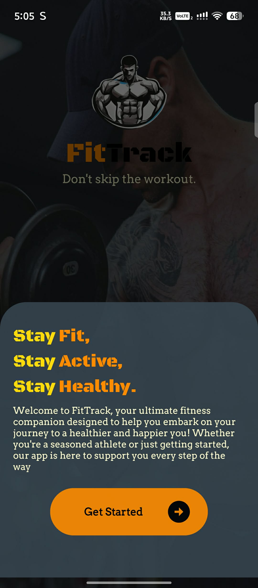
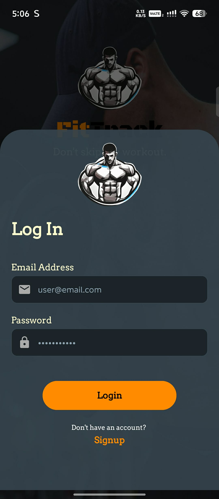
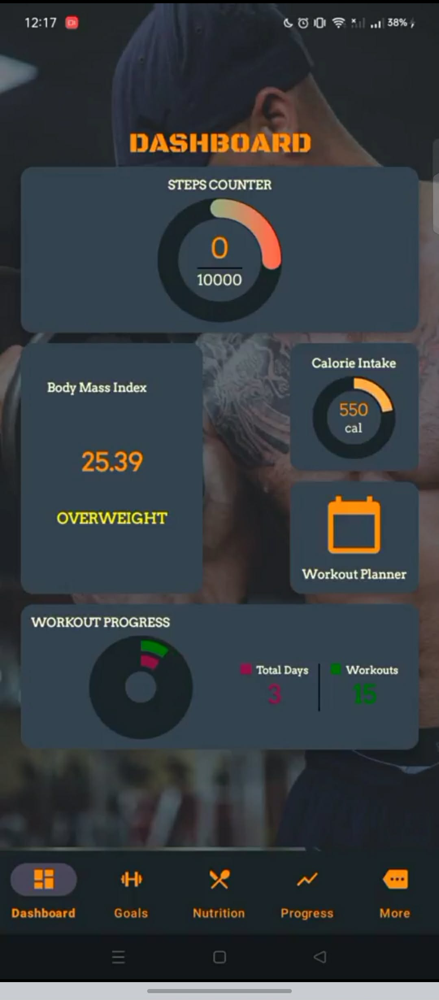
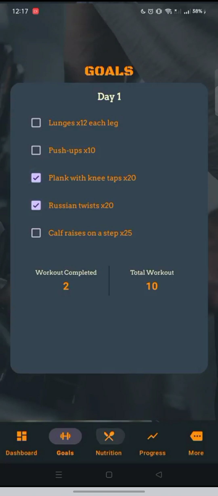

# FitTrack

**Don't skip the workout.**
A mobile fitness companion for tracking steps, calories, BMI, and daily workout goals in one place.

---

## Overview

FitTrack helps people stay consistent with their fitness journey, whether they're seasoned athletes or just getting started. Users sign up, see their daily health stats at a glance on a dashboard, and work through day-by-day workout checklists while tracking overall progress.

---

## Screenshots

| Get Started | Log In | Dashboard | Goals |
|:---:|:---:|:---:|:---:|
|  |  |  |  |

---

## Features

**Onboarding & authentication**
- Welcome screen with a quick "Get Started" entry point
- Email and password login
- Sign-up flow for new users

**Dashboard**
- **Steps counter** with a progress ring toward a daily goal (e.g. 10,000 steps)
- **Body Mass Index (BMI)** with a weight-category label
- **Calorie intake** tracker with a progress ring
- **Workout planner** shortcut
- **Workout progress** chart showing total days and completed workouts

**Goals**
- Day-by-day workout checklists (e.g. lunges, push-ups, planks with knee taps, Russian twists, calf raises)
- Tick off exercises as you finish them
- Live counters for workouts completed vs. total workouts

**Navigation**
- Bottom tab bar: Dashboard, Goals, Nutrition, Progress, and More

---

## Tech Stack

| Layer | Technology |
|---|---|
| Mobile app | Kotlin (native Android) |
| IDE | Android Studio |
| Backend | Firebase |

---

## Source Code

The source code for FitTrack is **private and not publicly available**. This repository is a showcase of the app only.

If you'd like to know more about how it was built, feel free to reach out through my GitHub profile: **[github.com/jhaylm-dev](https://github.com/jhaylm-dev)**.

---

## Roadmap

<!-- Optional: remove or edit -->
- [ ] Complete Nutrition and Progress screens
- [ ] Custom workout plans
- [ ] Reminders and notifications

---

## Author

**Jhay Landrei Marcelino**: Full-Stack Software Developer (Flutter, Dart, Go, Python, C#/.NET) based in Laguna, Philippines.

---

This repository is a portfolio showcase; the source code is not included.

© 2024 FitTrack. All rights reserved.
